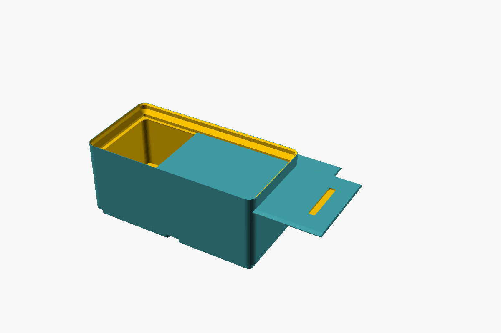
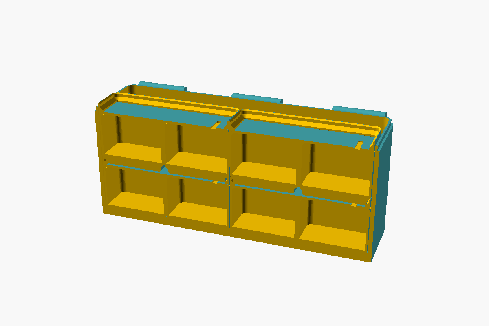
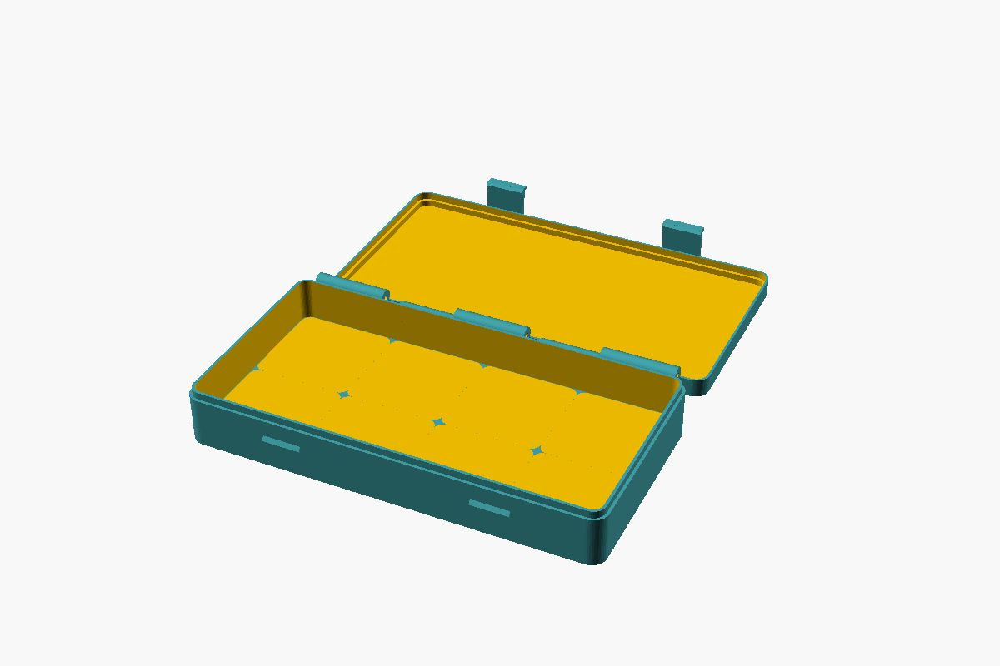
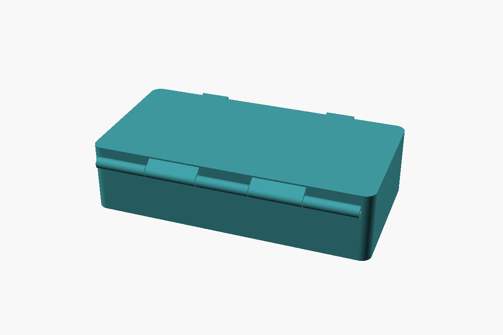
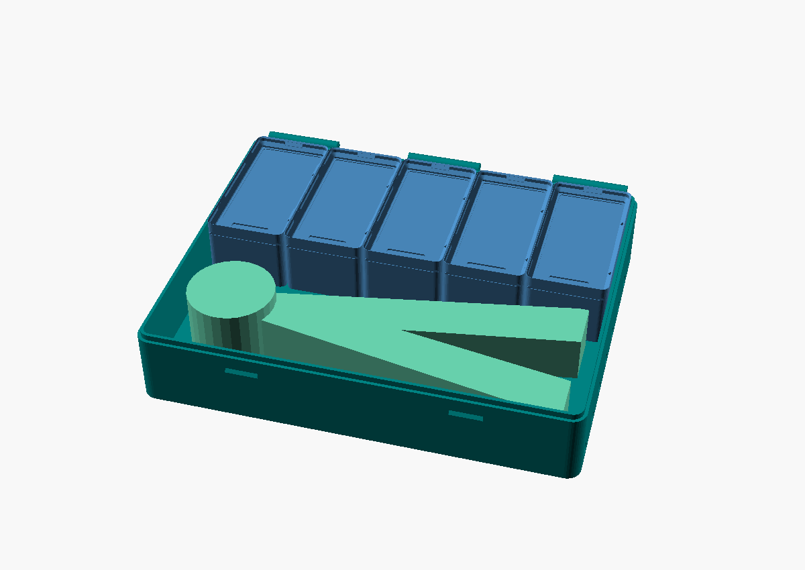
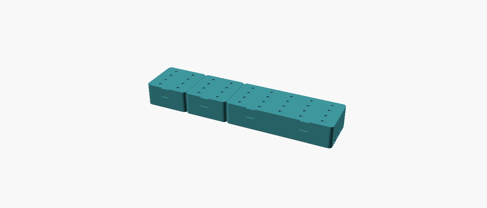
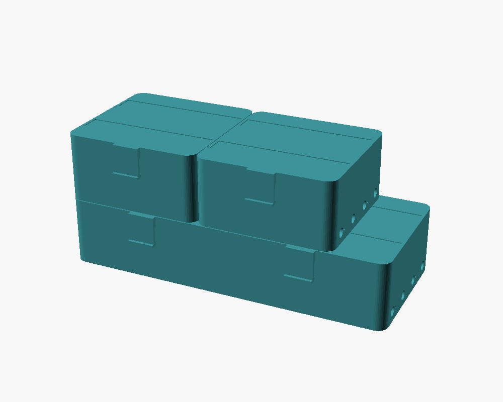

# Gridfinity-draagsysteem: overpakken zonder ompakken

**Het probleem:** schroevendraaiers en schroeven liggen los in een grote
Packout-koffer. Ga je met de motor, dan moet alles één voor één de rugzak in, en
daarna weer terug.

**Het idee:** de kleinste eenheid is een **stapelbaar bakje met schuifdeksel**.
Bakjes staan in **cassettes** (dichte doosjes met scharnier en klikbeugels,
binnenin een Gridfinity-raster). Je pakt de cassette over, of alleen de bakjes
die je nodig hebt: elk bakje is zelf al dicht.






## Opbouw

```
 bakje, half: 2,2 cm hoog      cassette                       Packout / rugzak
┌──────────────┐  schuif-    ┌──────────────────────┐
│ ▭▭▭▭▭▭▭▭▭▭▭▭ │◄─ deksel   │ [bakje][bakje]       │ ──► Large Tool Box
│  │    │    │ │             │ [bakje][bakje]       │ ──► rugzak
└──┴────┴────┴─┘             └──────────────────────┘ ──► low-profile organizer
   Gridfinity-voeten          binnen: Gridfinity 4,2 cm     (losse bakjes)
```

1. **Basis is het halve bakje:** 2,2 cm hoog, gestapeld telt het 1,75 cm.
   Twee halve zijn even hoog als één heel bakje (3,9 cm). Een heel bakje past
   precies in de **Packout low-profile organizer** (binnen ca. 4,6 cm), en
   twee halve dus ook.
2. **Schuifdeksel per bakje.** De deksel loopt in een groef vlak onder de
   stapelrand en rust op de tussenwanden, zodat elk vakje apart dicht is.
   Er zit geen klik op: de deksel schuift, en blijft door wrijving zitten. In de
   cassette houdt de wand ernaast hem op zijn plek. De groef is een
   zwaluwstaart met een plafond van 45°, zodat hij zonder support print.
3. **Stapelbaar, met klik.** De deksel zit onder de stapelrand, dus het bakje
   erboven valt gewoon met zijn Gridfinity-voeten in de rand. In de stapelrand
   zitten kleine nokjes (één per vak aan elke buitenkant) die in een groefje in
   de voeten van het bakje erboven klikken. Halve en hele bakjes kun je mengen.
   Kies per bakje aan welke kant de schuifdeksel eruit gaat, zodat je eerst het
   vakje opent dat je nodig hebt.
4. **Cassettes** hebben binnen een Gridfinity-raster (vakken van 4,2 cm). De
   binnenhoogte kies je in halve bakjes (een heel bakje telt als 2). De deksel
   van de cassette klemt de bovenste laag vast.

## Maten

Alle maten zijn buitenmaten. Een bakje is per vak 4,2 cm (precies 4,15 cm).

**Bakjes**

| Bestand | Vakken | Breed × diep × hoog |
|---|---|---|
| `bakje-1x1-half` / `-heel` | 1 | 4,2 × 4,2 × 2,2 / 3,9 cm |
| `bakje-2x1-vakjes-half` / `-heel` | 2 | 8,4 × 4,2 × 2,2 / 3,9 cm |
| `bakje-2x1-open-half` | 1 | 8,4 × 4,2 × 2,2 cm |
| `bakje-2x2-vakjes-half` / `-heel` | 4 | 8,4 × 8,4 × 2,2 / 3,9 cm |
| `bakje-2x2-2vakjes-heel` | 2 (elk 1 × 2 vakken) | 8,4 × 8,4 × 3,9 cm |
| `bakje-1x1-2vakjes-heel` | 2 (elk 1,8 × 3,9 cm, 2,6 cm diep) | 4,2 × 4,2 × 3,9 cm |
| `bakje-2x2-open-half` | 1 | 8,4 × 8,4 × 2,2 cm |
| `bakje-4x1-open-half` | 1 | 16,8 × 4,2 × 2,2 cm |

Een half bakje is binnen ca. 0,9 cm diep, een heel bakje ca. 2,6 cm.

Bij elk formaat hoort `schuifdeksel-<formaat>.stl`. Die past op het halve en
het hele bakje, met losse vakjes of open. Naast de greepsleuf zit een
uitsparing van 0,4 mm diep voor een sticker:

| Deksel | Stickervlak |
|---|---|
| 1×1 | 2,5 × 3,4 cm |
| 2×1 | 6,7 × 3,4 cm |
| 2×2 | 6,7 × 7,6 cm |
| 4×1 | 15,1 × 3,4 cm |

**Cassettes** (diepte inclusief scharnier en klikbeugels; met magneten)

| Bestand | Binnen | Breed × diep × hoog (dicht) |
|---|---|---|
| `cassette-2x2-4.5cm-schroeven` | 2 × 2 vakken, 2 halve bakjes hoog | 9,1 × 10,4 × 4,5 cm |
| `cassette-5x2-4.5cm-schroevendraaiers` | vlakke bodem voor een inleg, binnen 21,1 × 8,5 × 4,0 cm | 21,7 × 10,4 × 4,5 cm |
| `cassette-4x2-4.5cm` | 4 × 2 vakken, 2 halve bakjes (= 1 heel) hoog | 17,5 × 10,4 × 4,5 cm |
| `cassette-4x2-8.0cm` | 4 × 2 vakken, 4 halve bakjes (= 2 hele) hoog | 17,5 × 10,4 × 8,0 cm |

Elk bestand bestaat uit een `-onderbak` en een `-deksel`.

### Voorbeeld: krimptang voor adereindhulzen

`cassette-5x3-4.5cm-krimptang` (21,7 × 14,6 × 4,5 cm, binnen 21,1 × 12,7 cm)
voor een zelfinstellende krimptang van ca. 19,5 × 8 × 3 cm. De tang ligt op
de voorste twee rijen; in de achterste rij passen vijf `bakje-1x1-2vakjes-heel`:
één bakje per kabeldikte (bijvoorbeeld 0,5 / 0,75 / 1 / 1,5 / 2,5 mm²), met
links de adereindhulzen voor één ader en rechts die voor twee aders. Samen 10
vakjes; op de schuifdeksel van elk bakje een sticker met de maat.



Is je tang langer dan 20,5 cm, neem dan 6 vakken breed (`gx = 6`).

### Magneten en staalband: naast en op elkaar

- **Naast elkaar (Packout):** in beide zijwanden twee gaten per vak van 4,2 cm
  voor ronde magneetjes (standaard 6 × 2 mm), op een vaste hoogte vanaf de
  bodem. Zet de cassettes met de voorkant gelijk, dan liggen de magneten
  altijd tegenover elkaar, hoe breed of hoog de cassettes ook zijn.
- **Op elkaar (rugzak):** één magneet per vak in de bodem, en bovenop de
  deksel per rij vakken een verdiepte baan voor **zelfklevende staalband**
  (ferrotape, 12,7 mm breed, 0,5 mm dik) over de hele breedte. Een magneet pakt
  overal op de band, dus het maakt niet uit hoe ver een cassette opzij ligt.
  Zet de cassettes alleen met de voorkant gelijk.

Waarom staalband bovenop en geen magneten: elke cassette is 0,7 cm breder dan
zijn vakken. Met magneet-op-magneet loopt dat bij het stapelen op (hoe meer en
hoe breder de cassettes, hoe verder de magneten naast elkaar liggen). Met
staalband speelt dat niet.

Wanden en bodem zijn 3,2 mm dik, zodat er 1 mm achter een magneet blijft.

**Polariteit (alleen zijkanten):** neem een stapel magneten en zet een streepje
op de bovenste kant. Druk in de zijgaten **met een stipje** een magneet met het
streepje naar buiten, in de zijgaten **zonder stipje** met het streepje naar
binnen. Een druppel secondelijm erbij. Daarna trekt elke rechterkant elke
linkerkant aan. Bij de bodemmagneten maakt de richting niet uit.

### Voorbeeld: twee kleine cassettes en een grote

Twee `cassette-2x2-4.5cm-schroeven` voor kleine schroeven en één
`cassette-5x2-4.5cm-schroevendraaiers`:

| Waar | Zo | Totaal (b × d × h) |
|---|---|---|
| Packout | naast elkaar, voorkant gelijk | 39,9 × 10,4 × 4,5 cm |
| Rugzak | de twee kleine naast elkaar op de grote | 21,7 × 10,4 × 9,0 cm |




Gestapeld pakken de bodemmagneten van beide kleine cassettes op de staalband
van de grote, waar ze ook liggen.

**Maximaal op een printbed van 35 cm**

| Onderdeel | Max. vakken | Maat |
|---|---|---|
| Bakje of schuifdeksel | 8 × 8 | 33,6 × 33,6 cm |
| Cassette (onderbak of deksel) | 8 breed × 7 diep | 34,3 × 31,4 cm |
| Bakje + deksel op één plaat | 8 × 4 | 33,6 × 34,3 cm |

De generator rekent dit zelf uit voor de bedmaat die je instelt, en stopt met
een melding als iets niet past.

**In de Packout** (winkelopgaven, niet officieel; meet je eigen koffer na)

| Koffer | Binnenmaat (ca.) | Wat past |
|---|---|---|
| Large Tool Box 48-22-8425 | 478–500 × 335–340 × 216–229 mm | per laag 6 cassettes 4×2 (2 naast, 3 achter elkaar); in de hoogte bijvoorbeeld 2× 8,0 cm + 1× 4,5 cm (20,5 cm) |
| Low-profile organizer 48-22-8431 | 457 × 305 × 46 mm | Gridfinity-bodem van 10 × 7 vakken, losse hele bakjes (3,9 cm) of twee halve op elkaar |

Voor de low-profile organizer haal je de originele bakjes eruit en leg je een
Gridfinity-baseplate in de bodem (bijvoorbeeld
[deze op MakerWorld](https://makerworld.com/en/models/1534482-gridfinity-base-for-packout-low-profile-organizer)).

## Printen

Kant-en-klare STL's staan in [`stl/`](stl/).

- **Materiaal:** PETG (aanbevolen voor de klikbeugels en het scharnier van de
  cassette; PLA wordt na een tijdje bros en kan in een warme koffer vervormen).
- **Bakjes** rechtop, **schuifdeksels** plat, **cassette-onderbak** rechtop,
  **cassette-deksel** met de bovenkant op het bed (de STL's zijn al zo
  georiënteerd). Geen support nodig.
- 3 wanden, 15–20 % infill.
- **Steuntjes in de sleuf:** in de sleuf aan de voorkant van elk bakje staan
  twee hele dunne steuntjes, zodat de brug erboven kort blijft. Die drukt de
  deksel er de eerste keer uit; eventuele restjes haal je weg met een mesje.
- **Scharnierpen cassette:** schuif een stuk 1,75 mm filament door de knokkels
  en smelt of knip de uiteinden iets dikker.

## Zelf genereren

Alles komt uit één bestand: [`generator.scad`](generator.scad). Je kiest wat je
wilt printen en hoe groot, en krijgt een STL.

**In de browser, zonder installatie:** open op MakerWorld de *Parametric
Model Maker* (onder MakerLab) en laad `generator.scad`. Je krijgt dezelfde
keuzelijsten en schuifjes en downloadt een printklare 3MF. Het bestand is één
los bestand en werkt met OpenSCAD 2021, de versie die MakerWorld gebruikt.

**Op je pc met OpenSCAD** (gratis, [openscad.org](https://openscad.org)):

1. Open `generator.scad`.
2. Zet de Customizer aan: *Window → Customizer* (of *Venster → Customizer*).
3. Kies onder *Wat wil je printen?* het onderdeel en stel de maat in.
4. Druk **F6** (renderen) en daarna **F7** (STL exporteren).

**Instellingen**

| Groep | Instelling | Betekenis |
|---|---|---|
| Wat wil je printen? | `onderdeel` | bakje, schuifdeksel, bakje + deksel, cassette-onderbak, cassette-deksel, beide, of een voorbeeld |
| Maat | `gx`, `gy` | breedte en diepte in vakken, met de maat in cm erbij; geldt voor bakje én cassette |
| Bakje | `hu` | half (2,2 cm, standaard) of heel (3,9 cm); twee halve = één heel |
| | `vakken` | elk vak apart, één open ruimte, of eigen aantal vakjes |
| | `vakjes_x`, `vakjes_y` | aantal vakjes in breedte en diepte (bij eigen aantal) |
| | `deksel` | uit = open bakje zonder groef |
| Schuifdeksel | `lid_fit` | speling in de groef, per kant (0,1 getest: strak, schuift goed) |
| | `label_d` | diepte van de stickeruitsparing (0 = geen) |
| | `steunen` | breekbare steuntjes in de sleuf aan de voorkant, per vak van 4,2 cm (0 = geen) |
| | `klik` | klein nokje tegen vanzelf openschuiven (standaard uit) |
| | `schuif` | kant waar de deksel uit schuift: rechts, links, voor of achter |
| Stapelen | `stapel_klik` | hoe ver de klik-nokjes in de stapelrand ingrijpen (0,2 mm; 0 = geen klik) |
| Cassette | `lagen` | binnenhoogte in halve bakjes (1–6), met de hoogte van de dichte cassette in cm erbij |
| | `baseplate` | uit = vlakke bodem voor een schuim- of TPU-inleg |
| | `lid_gap` | speling tussen bovenste bakje en deksel (kleiner = vaster) |
| Cassette - magneten | `magneten` | magneetgaten en staalbaan aan; uit = dunnere bodem |
| | `magneet_d`, `magneet_h` | maat van je magneten (de wand wordt zo nodig dikker) |
| | `magneet_speling` | extra ruimte in het gat (0,1–0,2 = klemmend) |
| | `staalband_b`, `staalband_t` | breedte en dikte van je staalband |
| Printer | `bed` | maat van je printbed in mm (standaard 350) |

De schuifdeksel past op elk bakje met dezelfde `gx` × `gy`, heel of half.
De deksel schuift er aan de rechterkant (+x) uit. Bij een bakje van 4×1 is dat
de korte kant.

**Vanaf de commandoregel:**

```sh
openscad -D 'onderdeel="bakje"'        -D gx=3 -D gy=1 -o bakje-3x1.stl  generator.scad
openscad -D 'onderdeel="schuifdeksel"' -D gx=3 -D gy=1 -o deksel-3x1.stl generator.scad
openscad -D 'onderdeel="cassette_onderbak"' -D gx=3 -D gy=2 -D lagen=4 -o onderbak.stl generator.scad
```

[`maak_stls.sh`](maak_stls.sh) maakt de complete standaardset in `stl/` opnieuw.

## Nog niet getest

De modellen zijn gerenderd, gecontroleerd op geldige geometrie en in
doorsnede nagemeten (stapelen, deksel in de groef, scharnier, klikbeugels),
en de schuifdeksel van een 1×1-bakje is geprint en getest (speling 0,1 mm is
goed). Print nog één `cassette-2x2-4.5cm-schroeven` en een paar bakjes, en controleer:

1. Valt een bakje goed op een ander bakje en in de cassette?
2. Passen je magneten in de gaten? Te los: verklein `magneet_speling`.
3. Klikken de beugels van de cassette goed? Te stug: maak `latch_t` dunner.
   Te los: vergroot `ridge_d`.
4. Passen twee halve bakjes (of één heel) in jouw low-profile organizer met de
   Gridfinity-bodem erin?
