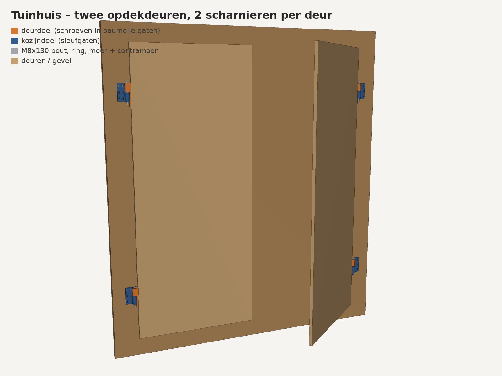
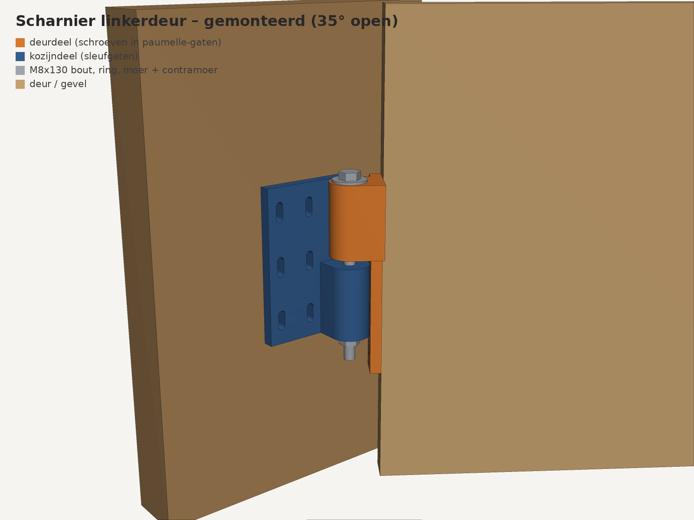
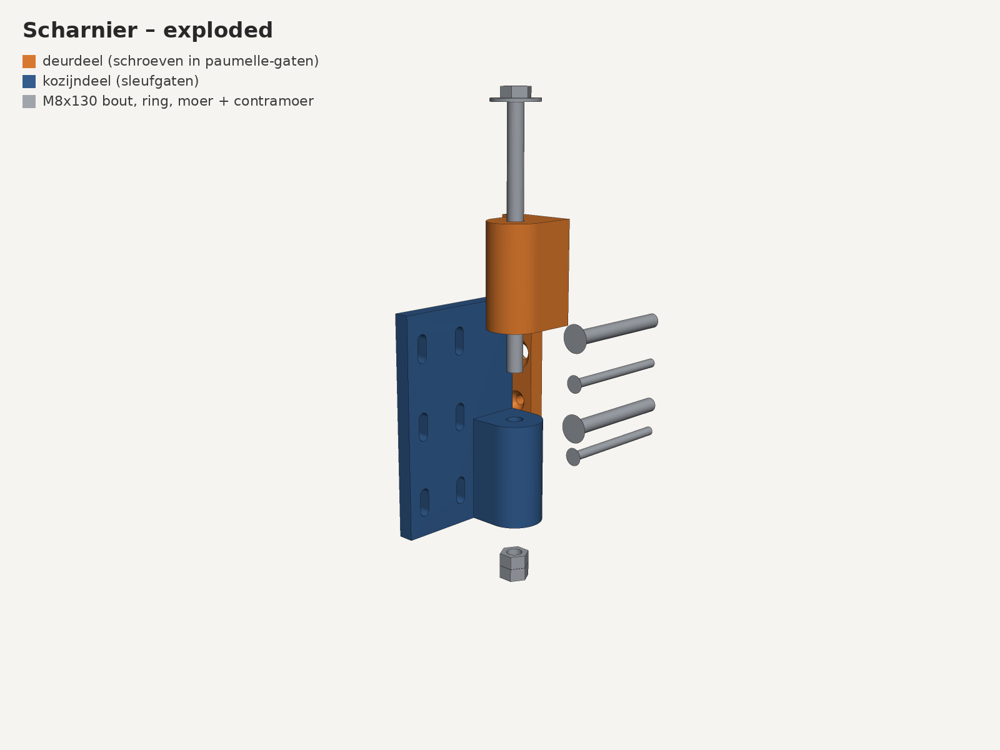
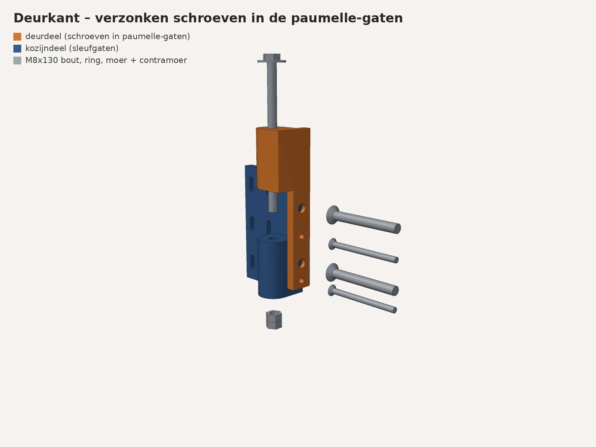
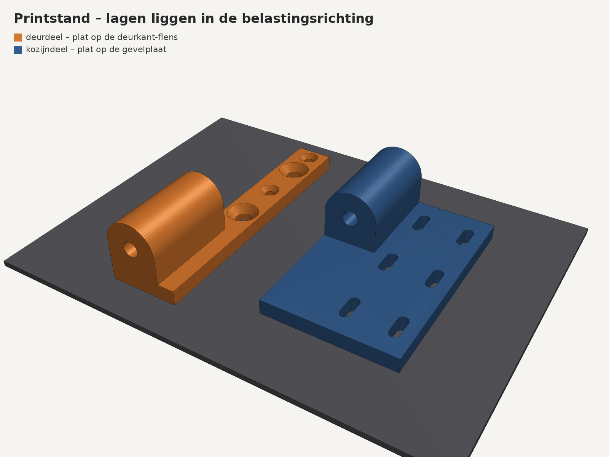

# Verstelbare scharnieren voor de dubbele opdekdeuren van het tuinhuis (v2)

3D-printbaar scharnier dat de oude paumelles vervangt. Het gebruikt de
bestaande paumelle-gaten in de deurkant en is met schroeven in hoogte te
stellen. **In v2 draagt staal de deur en klemt het plastic alleen.**







## Waarom v1 brak en wat er in v2 anders is

| v1 (brak) | v2 |
|---|---|
| Rechtop geprint: de lagen lagen dwars op de buigspanning in de flenzen, met een scherpe hoek precies op een laagnaad. | **Plat geprint** op de flens die tegen het hout komt: de lagen liggen in het vlak van de belasting. |
| Flenzen 5 mm, knokkels Ø22. | Flenzen **8 mm**, knokkels **Ø28**, de brug onder de knokkel loopt over de volle breedte en hoogte. |
| De deur hing op de punt van een bout die half in een blind gat stak. | **Doorgaande M8-bout** door beide knokkels: de bout neemt de dwarskracht, het plastic krijgt alleen druk. |
| Geprinte pennen in de paumelle-gaten. | **Stalen verzonken schroeven** in de paumelle-gaten. |

## Hoe het werkt
- **Deurdeel (oranje):** flens op de deurkant, met 2 verzonken schroeven 8 mm in de paumelle-gaten plus 2 schroeven 5×50. Bovenste knokkel.
- **Kozijndeel (blauw):** plaat op de voorkant van kozijn/gevel naast de deur, met 6 sleufgaten (±4 mm grof). Onderste knokkel met een M8-moer die van onderen in een zeskant zit.
- **Hoogte:** de deur hangt aan de boutkop (met een brede sluitring). Draai je de kop met een sleutel 13, dan draait de bout in de ingesloten moer en gaat de deur omhoog of omlaag (fijn, ongeveer −3/+4 mm). Borg daarna met de contramoer onder.
- De deur draait vrij van 0 tot 180°. Ik heb dat doorgerekend op botsingen.

## Sterkte (grove handberekening)
Aanname: deur 25 kg, 80 cm breed, scharnieren 130 cm uit elkaar, en iemand die met 50 kg op de open deur leunt. Eén scharnier vangt dan ongeveer 750 N verticaal en 380 N horizontaal op.

| Plek | Spanning | PETG/ASA kan |
|---|---|---|
| M8-bout op afschuiving | ~8 MPa | staal 8.8: >400 MPa |
| Stuik bout op de boring (Ø8 × 52 mm) | ~1 MPa | ~50 MPa |
| Ring DIN 9021 Ø24 op de knokkel | ~2 MPa | ~50 MPa |
| Buiging brug knokkel → flens (28 × 52 mm) | ~1,5 MPa, in het laagvlak | ~40 MPa |
| Ingesloten moer op het plastic | ~8 MPa, in het laagvlak | ~50 MPa |

Overal zit een veiligheidsfactor van 5 of meer. De zwakste schakel is nu het hout en de schroeven, niet de print.

## Stuklijst voor 2 deuren × 2 scharnieren

| Wat | Aantal |
|---|---|
| `stl/deurdeel_linkerdeur.stl` + `stl/kozijndeel_linkerdeur.stl` | 2 + 2 |
| `stl/deurdeel_rechterdeur.stl` + `stl/kozijndeel_rechterdeur.stl` | 2 + 2 |
| Zeskantbout **M8×130 DIN 931** (deels draad, verzinkt of RVS) | 4 |
| Moer M8 | 8 |
| Carrosseriering M8 DIN 9021 (Ø24) | 4 |
| Verzonken constructieschroef 8 mm (bijv. 8×60) **die in de paumelle-gaten bijt** | 8 |
| Verzonken houtschroef 5×50 (deurdeel) | 8 |
| Houtschroef 5×50 met platte kop of ring (kozijndeel) | 24 |

Links en rechts zijn **van buiten gezien met de deuren dicht**: de linkerdeur scharniert aan de linkerkant.

## Monteren
1. Druk een moer van onderen in de zeskant van het kozijndeel.
2. Schroef de deurdelen op de deur **voordat je de deur ophangt**: de 8 mm schroeven in de paumelle-gaten, de 5 mm schroeven ernaast.
3. Zet de kozijndelen met de sleufgaten op de gevel en houd de deur ertegen. Steek de bout met de ring van boven door beide knokkels en draai hem in de moer. Draai de contramoer erop.
4. Zet de hoogte eerst grof met de sleufgaten en draai de schroeven vast. Stel daarna fijn af met de boutkop en zet de contramoer vast. Een beetje vet op de bout helpt.

## Printen
- De STL's liggen al in printstand (plat), zonder support.
- **PETG of ASA**, 0,2 mm laag, **6 perimeters, 50 % gyroid infill**, 5 boven- en onderlagen.
- Elk deurdeel is ~63 cm³, elk kozijndeel ~93 cm³. Voor alle 8 onderdelen heb je ongeveer 0,8 kg filament nodig.

## Maten aanpassen
Bovenin `scharnier.py`: `DOOR_T` (deurdikte), `HOLE_PITCH` (hart-op-hart van de paumelle-gaten),
`HOLE_Y` (hart gat tot achterkant deur), `HOLE_TOP_Z` en `HOLE_SCREW_D`.
```
pip install manifold3d trimesh pillow numpy
python3 scharnier.py   # STL's -> stl/
python3 render.py      # PNG's -> render/
```
